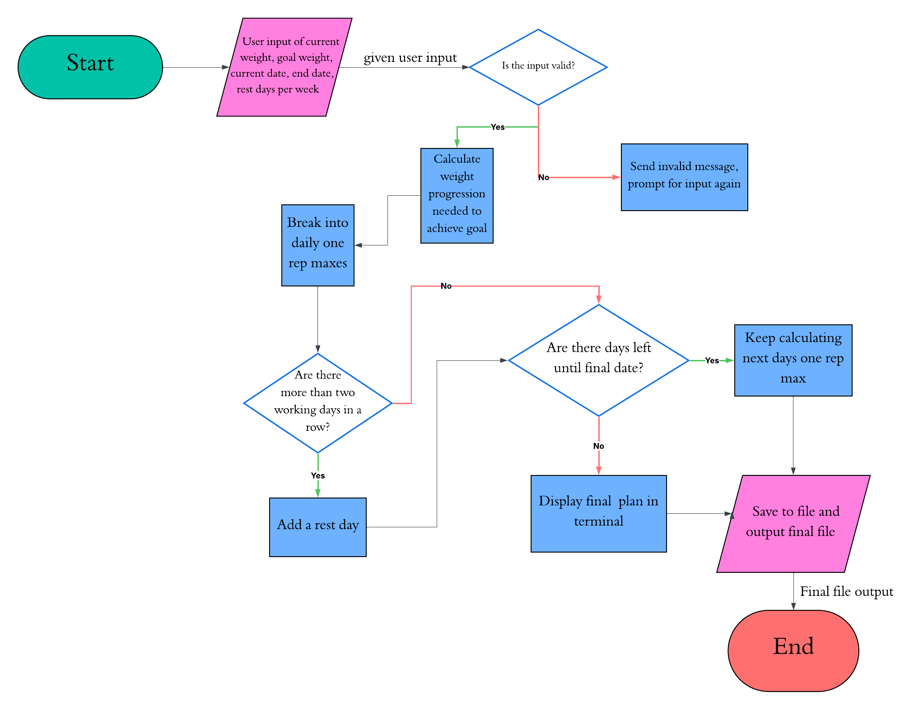

# Workout Progression Generator

Calculates a daily one rep max progression on a given exercise in order to reach a desired one rep max by a particular date

## The Problem

Reaching a specific strength goal or target weight on an exercise can often be difficult to optimally plan and track. Breaking a final goal into calculated and manageable daily lifts is often overlooked, or frequently done wrong by not adapting to missed workouts, daily strength, etc.

## How It Works

Takes user input such as a goal weight that the user wants to perform for a one rep max, their current one rep max, the date they want to achieve the goal, and the current date. The program will then output a structured program to slowly build strength progression to achieve the desired one rep max on the desired day, factoring in rest and failed lifts.

## Tech Stack

- **Language:** Java
- **Libraries:** LocalDate, BufferedReader, PrintWriter, FileOutputStream, SpringValidation, SpringBoot
- **External tools:** IntelliJ Idea

## Roadmap

- [ ] Create front end
- [ ] Automatically adjust programming based on missed days / failure to achieve daily weight
- [ ] Implement de-load weeks

## Author

Blake Hall, [Github Page](https://github.com/Blake-h011)
